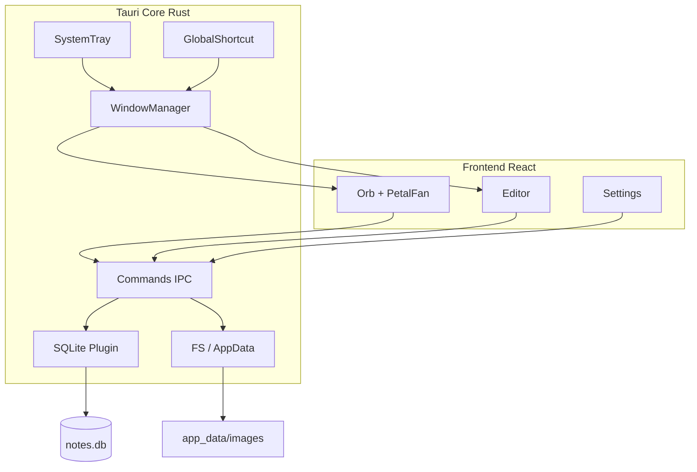

# 花记（PetalJot）桌面花瓣便签 — 技术设计文档

> 状态：已落盘  
> 平台：macOS + Windows  
> 技术栈：Tauri 2 + React + TypeScript + Vite  
> 文档版本：v1.0  
> 路径：`RNT/docs/design.md`（产品名：花记 / PetalJot）

---

## 1. 背景与目标

现有桌面便签普遍唤出慢、最近记录难达、输入方式单一。花记（PetalJot）以「桌面常驻圆球 + 悬停花瓣扇」作为主入口，目标是：

1. **快捷可达**：圆球常在 / 全局快捷键 / 托盘，三路唤出。
2. **最近即用**：悬停 ≥2s 扇出最近 N 条（默认 8），中心加号新建。
3. **多模态记录**：手动输入、插图；语音为二期能力但架构预留。
4. **轻量常驻**：Tauri 壳，低内存占用，适合开机自启场景。

非目标（MVP 不做）：云同步、多用户、富文本协作、本地大模型 ASR。

---

## 2. 术语

| 术语 | 含义 |
|------|------|
| Orb | 桌面悬浮圆球窗口 |
| Petal | 花瓣单元，对应一条最近便签摘要 |
| Fan | 以 Orb 为圆心的扇形花瓣布局 |
| SafeZone | 展开后鼠标可停留而不收起的命中区域 |
| Editor | 便签编辑窗口 |
| Note | 一条本地便签记录 |

---

## 3. 总体架构



### 3.1 进程与窗口

| 窗口 label | 职责 | 关键属性 |
|------------|------|----------|
| `orb` | 悬浮球 + 花瓣 | transparent, undecorated, alwaysOnTop, skipTaskbar, resizable=false |
| `editor` | 新建/编辑便签 | 普通窗，居中，可调整大小 |
| `settings` | 瓣数/快捷键/显隐等 | 普通小窗 |

单 WebView 多路由可行，但 Orb 需长期透明置顶且频繁改 bounds，**首版采用多窗口 + 独立入口 HTML/路由**，降低互相干扰。

### 3.2 跨窗事件

| Event | 方向 | 用途 |
|-------|------|------|
| `notes://changed` | Editor/Settings → Orb | 刷新花瓣列表 |
| `orb://visibility` | Tray/Hotkey → Orb | 显示/隐藏球 |
| `editor://open` | Orb/Tray/Hotkey → Editor | `{ mode: "create" \| "edit", id?: string }` |
| `settings://updated` | Settings → Orb | 瓣数、扇角等即时生效 |

---

## 4. 技术选型与依赖

| 能力 | 选型 | 说明 |
|------|------|------|
| 应用壳 | Tauri 2 | 跨 macOS/Windows，体积与占用优于 Electron |
| UI | React 18 + TS + Vite | 花瓣动画与编辑器 |
| 动画 | Framer Motion | stagger / layout morph |
| DB | tauri-plugin-sql (SQLite) | 本地持久化 |
| 快捷键 | tauri-plugin-global-shortcut | 全局唤出 |
| 托盘 | tauri-plugin-tray / 内置 Tray | 显隐、退出 |
| 语音（二期） | Web Speech API | 不可用则录音降级占位 |
| 图片 | 复制到 appData + 相对路径引用 | 不入库 BLOB |

---

## 5. 目录结构

```
PetalJot/（仓库目录现为 RNT/）
  docs/
    design.md                 # 本文档
  package.json
  vite.config.ts
  index.html                  # 可按多页拆 orb.html / editor.html
  src/
    orb/
      OrbApp.tsx
      PetalFan.tsx
      useHoverExpand.ts
      geometry.ts             # 扇形角度、坐标计算
    editor/
      EditorApp.tsx
      TitleInput.tsx
      BodyEditor.tsx
      ImageInsert.ts
      VoiceButton.tsx         # 二期
    settings/
      SettingsApp.tsx
    shared/
      types.ts
      api/notes.ts            # invoke 封装
      api/settings.ts
      events.ts
      constants.ts
  src-tauri/
    tauri.conf.json
    capabilities/
    src/
      main.rs
      lib.rs
      commands/
        notes.rs
        settings.rs
        images.rs
        windows.rs
      state.rs
```

---

## 6. 数据设计

### 6.1 Schema

```sql
CREATE TABLE IF NOT EXISTS notes (
  id          TEXT PRIMARY KEY NOT NULL,
  title       TEXT NOT NULL DEFAULT '',
  body        TEXT NOT NULL DEFAULT '',
  cover_image TEXT,
  pinned      INTEGER NOT NULL DEFAULT 0,
  created_at  INTEGER NOT NULL,
  updated_at  INTEGER NOT NULL,
  deleted_at  INTEGER
);

CREATE INDEX IF NOT EXISTS idx_notes_feed
  ON notes (deleted_at, pinned DESC, updated_at DESC);

CREATE TABLE IF NOT EXISTS settings (
  key   TEXT PRIMARY KEY NOT NULL,
  value TEXT NOT NULL
);
```

### 6.2 领域类型（TS）

```ts
type Note = {
  id: string;
  title: string;
  body: string;
  coverImage: string | null;
  pinned: boolean;
  createdAt: number;
  updatedAt: number;
  deletedAt: number | null;
};

type NoteSummary = Pick<Note, "id" | "title" | "coverImage" | "updatedAt" | "pinned"> & {
  excerpt: string; // body 前 40~60 字，去 markdown 噪音
};

type AppSettings = {
  petalCount: number;      // 4~12，默认 8
  fanArcDeg: number;       // 默认 180
  fanStartDeg: number;     // 默认 -90（正上方起算约定见几何节）
  hoverDelayMs: number;    // 默认 2000
  collapseDelayMs: number; // 默认 150
  orbVisible: boolean;
  orbX: number;
  orbY: number;
  hotkeyNew: string;       // mac: Cmd+Shift+N / win: Ctrl+Shift+N
  hotkeyOrb: string;       // mac: Cmd+Shift+Space / win: Ctrl+Shift+Space
};
```

### 6.3 图片存储约定

- 路径：`{appDataDir}/images/{noteId}/{uuid}.{ext}`
- `body` 内引用：`` 或自定义协议，由前端经 `convertFileSrc` 解析。
- `cover_image`：首次插入图或用户指定的首图相对路径。
- 删除便签（软删）不立即删文件；二期提供「清理无引用图片」。

---

## 7. IPC 命令契约

| Command | 入参 | 出参 | 说明 |
|---------|------|------|------|
| `notes_list_recent` | `{ limit: number }` | `NoteSummary[]` | 花瓣数据源 |
| `notes_get` | `{ id: string }` | `Note` | 打开编辑 |
| `notes_upsert` | `Note`（id 空则创建） | `Note` | 自动保存 |
| `notes_soft_delete` | `{ id: string }` | `void` | 软删 |
| `images_save` | `{ noteId, bytes|path, ext }` | `{ relativePath }` | 落盘 |
| `settings_get` | — | `AppSettings` | |
| `settings_set` | `Partial<AppSettings>` | `AppSettings` | |
| `orb_set_visible` | `{ visible: boolean }` | `void` | |
| `orb_set_position` | `{ x, y }` | `void` | 拖拽结束持久化 |
| `orb_resize_for_fan` | `{ expanded: boolean, radius: number }` | `void` | 展开时放大窗口 |
| `editor_open` | `{ mode, id? }` | `void` | 由 Rust 聚焦/创建 editor 窗 |

错误统一：`{ code: string, message: string }`，前端 toast/静默按场景处理。

---

## 8. 交互与状态机

```mermaid
stateDiagram_v2
  [*] --> Hidden: orbVisible=false
  [*] --> BallIdle: orbVisible=true
  Hidden --> BallIdle: 托盘显示或热键
  BallIdle --> Hidden: 托盘隐藏
  BallIdle --> HoverPending: pointerenter
  HoverPending --> BallIdle: pointerleave 且未满 delay
  HoverPending --> PetalOpen: hoverDelayMs 到达
  PetalOpen --> CollapsePending: pointerleave SafeZone
  CollapsePending --> PetalOpen: 重新进入
  CollapsePending --> BallIdle: collapseDelayMs 到达
  BallIdle --> EditorOpen: 热键新建
  PetalOpen --> EditorOpen: 点击加号或花瓣
  EditorOpen --> PetalOpen: 关闭编辑且仍在展开态
  EditorOpen --> BallIdle: 关闭编辑且已收起
```

### 8.1 Orb 行为细则

1. 默认尺寸：逻辑 56×56；展开半径 `R = 140 + petalSize/2`（petal 约 88×64）。
2. 拖拽：短按移动；与点击加号区分（移动超过 4px 视为拖拽，抑制 click）。
3. 贴边：松手时若距屏边 < 12px 则吸附；多显示器取当前屏 workArea。
4. 隐藏：`orb` 窗 `hide()`，不销毁；热键新建仍可用。

### 8.2 花瓣几何

约定：0° 为时钟 3 点方向，逆时针为正（或统一用「从 fanStart 起沿 fanArc 均分」）。

```
对于 i in [0, n):
  angle = fanStartDeg + (fanArcDeg * (i + 0.5) / n)
  x = cx + cos(rad(angle)) * radius
  y = cy + sin(rad(angle)) * radius
```

- `n = min(notes.length, petalCount)`；n=0 时只显示中心加号。
- 默认 `fanStartDeg = -180`, `fanArcDeg = 180` → 上半扇，减少挡 Windows 任务栏。
- 窗口坐标系：花瓣用 CSS absolute；展开前 Rust 将 `orb` 窗扩到外接正方形，球心保持视觉位置（改 position 补偿）。

### 8.3 动画规格

| 阶段 | 属性 | 时长 | 缓动 | 备注 |
|------|------|------|------|------|
| 球 → 加号 | morph / rotate opacity | 200ms | easeOut | 与展开同时 |
| 花瓣入场 | opacity 0→1, scale 0.6→1, 沿半径 0.7R→R | 320ms | spring 或 easeOutBack | stagger 30ms |
| 花瓣退场 | 反向 | 220ms | easeIn | stagger 20ms 反向 |
| 安全区离开 | 无视觉 | 150ms | — | 防抖收起 |

---

## 9. 编辑器设计

### 9.1 布局

- 顶栏：标题输入（单行）
- 工具条：插入图片、（二期）按住说话、置顶开关
- 主区：纯文本/轻 Markdown textarea 或 contenteditable（MVP 用 textarea + 图片以 markdown 语法插入）
- 状态：右下角「已保存 / 保存中」

### 9.2 自动保存

- debounce 500ms 对 `title/body` 变更调用 `notes_upsert`
- `window close requested`：flush 未保存变更后再关
- 新建：打开编辑器时即分配 uuid 并插入空行，避免图片无 noteId

### 9.3 图片插入

优先级：剪贴板粘贴 → 拖拽文件 → 文件选择器。  
支持 `png/jpg/jpeg/gif/webp`；单张上限 10MB（超限提示）。

### 9.4 语音（二期，MVP 预留按钮 disabled 或隐藏）

1. 检测 `window.SpeechRecognition || webkitSpeechRecognition`
2. 可用：按住开始、松开结束，interim 结果写入光标处
3. 不可用：提示当前环境不支持；预留 `voice_start_capture` Rust 命令接口

---

## 10. 托盘与快捷键

### 托盘菜单

- 新建便签
- 显示/隐藏悬浮球
- 设置
- 退出

### 默认快捷键

| 动作 | macOS | Windows |
|------|-------|---------|
| 新建 | Command+Shift+N | Control+Shift+N |
| 显示并聚焦 Orb | Command+Shift+Space | Control+Shift+Space |

设置页可改；冲突时注册失败并提示。

---

## 11. 窗口与平台差异

### macOS

- 透明窗：`transparent: true` + CSS 背景透明
- 麦克风权限：二期 Info.plist `NSMicrophoneUsageDescription` / 语音识别说明
- Dock：可设 accessory 减少占位（可选）

### Windows

- 依赖 WebView2 Runtime
- 透明与圆角在 Win10/11 表现差异需实机测；花瓣用 CSS 圆角自绘，不依赖窗体圆角
- 任务栏旁坐标使用 `monitor.work_area`
- 全局快捷键避免与系统冲突

### 高 DPI

- 一律用 Tauri 逻辑坐标 API；前端花瓣半径按 `devicePixelRatio` 仅影响渲染清晰度，不混用物理像素改窗体。

---

## 12. 安全与权限

- IPC 仅白名单 commands；capabilities 最小授权（fs 限 appData、sql、global-shortcut、dialog）。
- 自定义协议/convertFileSrc 仅允许 appData/images 下路径，防任意读盘。
- 无网络请求（MVP）；后续 ASR/同步再开 scope。

---

## 13. 分期与里程碑

### M1 — MVP

- 工程脚手架、三窗口骨架
- SQLite + settings
- Orb 拖拽/显隐/位置记忆
- 2s 悬停花瓣 + 加号 + 动画
- Editor 文本 + 插图 + 自动保存
- 托盘 + 全局新建快捷键

### M2

- 语音输入
- 置顶 / 软删 / 简单搜索
- 扇区方向与 hover 时长设置
- Orb 热键聚焦

### M3（可选）

- 开机自启、多编辑窗、回收站清理、云同步

---

## 14. 验收标准

### M1

1. 冷启动后桌面出现可拖拽圆球；托盘可隐藏/显示，重启位置与显隐正确。
2. 悬停满 2s：中心变为加号，最近记录扇形展开，有 stagger 动画；移出 SafeZone 后收起。
3. `petalCount` 默认 8，设置 4~12 后下次展开立即按新数量。
4. 点击加号新建，点击花瓣打开对应便签；保存后花瓣摘要更新。
5. 粘贴/选择图片后关闭再开，图片仍可显示。
6. 全局快捷键在其它应用前台时可唤出新建窗。
7. macOS、Windows 均可运行（Win 需 WebView2）。

---

## 15. 风险与对策

| 风险 | 影响 | 对策 |
|------|------|------|
| 透明置顶窗在 Windows 点击异常 | Orb 难用 | 展开时扩大实体命中层；避免 click-through |
| 展开时窗口 resize 导致球心跳动 | 体验差 | resize 与 setPosition 同步补偿 |
| WebView 无 SpeechRecognition | 语音不可用 | M2 降级提示 + 接口预留 |
| 花瓣过多遮挡桌面 | 干扰 | 默认上半扇 + 上限 12 |
| 自动保存与快速关窗丢数据 | 丢内容 | close 前同步 flush |

---

## 16. 下一步

1. 按 M1 初始化 Tauri 2 + React/TS/Vite 工程（多窗口入口）。
2. 实现 SQLite / settings / 图片落盘 IPC。
3. 打通 Orb 悬停花瓣闭环，再接 Editor 与托盘快捷键。
